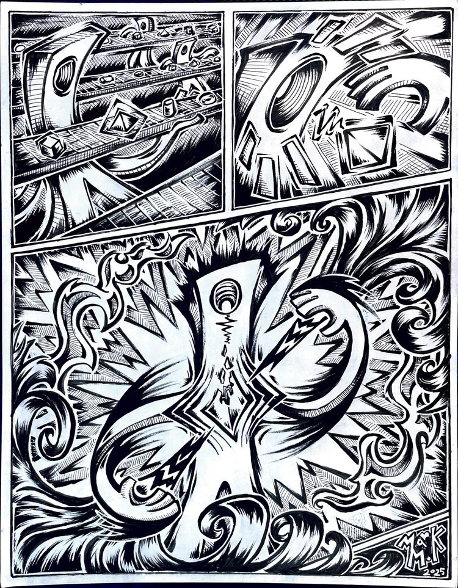

# Funkjamin PRIME
Mark Melkumyan | CIS 5660

## Art Piece
[Factory of Forms](https://www.marklikes.art/comics) by Mark Melkumyan (me!)

3D model prcoedurally made by me in Houdini (see `funkjaminPrime.hipnc`)

## Features

Surface Shader
- Cell shading style
- Multiple light support
- Texture support
- Specular highlight

Screenspace Outlines
- Normals/Depth based outlines

Inverse Hull Outlines
- With animated noise to make the hull move over time
  - Tuned with high frequency noise to make spikey points! 
- Set the center of noise as a point in 3D space. This way you can make the noise move out radially.

Fullscreen Postprocess
- Spikey vignet full screen shader 
- Animates/rotates around the screen border

Scene
- Simple scene with Funkjamin Prime holding a lil object
- Simple turntable to rotate him over time

Interactivity
- Press space to swap his material color